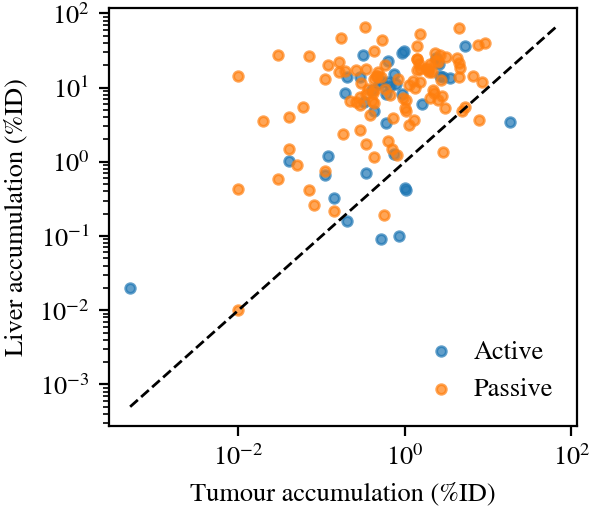
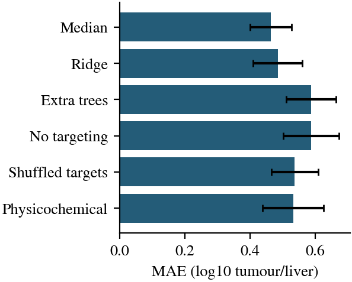
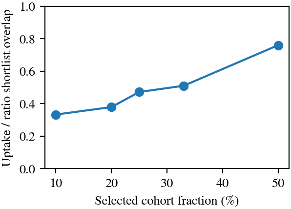
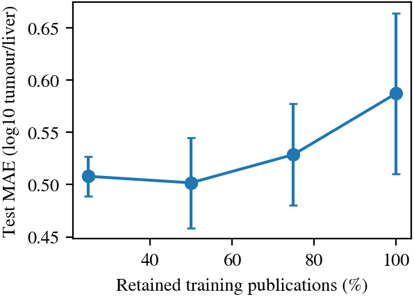

# Tumour accumulation is not tumour-to-liver selectivity: a publication-aware polymer nanoparticle reanalysis

Shereen Anand | PES University | pes1202201328@pesu.pes.edu

## Abstract

Selecting a polymer nanoparticle solely for tumour accumulation can ignore competing liver uptake. We quantify the relationship between these ranking objectives using paired whole-organ biodistribution measurements from the publicly archived Nano-Tumor Database. The primary cohort contains 142 source-labelled Polymeric formulations in 72 connected publication-reference groups, evaluated at 24 hours without temporal extrapolation. Analyses include publication-cluster bootstrap intervals, within-publication active/passive contrasts, fixed baseline prediction models and prespecified time/material sensitivity analyses.

Median tumour and liver accumulation were 0.625%ID and 9.750%ID. Tumour accumulation and the tumour/liver ratio had Spearman correlation 0.561 (publication-bootstrap 95% interval 0.396 to 0.707); only 47.2% of the top-quartile formulations overlapped between objectives. The equal-weight within-publication active/passive log10-ratio contrast was 0.209 (0.091 to 0.325) across 15 overlapping publication groups.

Additional objective-weight, publication-omission and capacity ablations preserve the primary cohort. Leave-one-group-out within-publication contrasts range from 0.183 to 0.244 log10 units. The observational contrast remains confounded, and organ selectivity is not a validated safety or efficacy endpoint.

<b>Keywords:</b> polymer nanoparticles; tumour biodistribution; liver uptake; active targeting; publication clustering.

## Introduction

Nanoparticle delivery is a multiorgan distribution problem. Tumour accumulation may coexist with substantial clearance-organ uptake, and a material selected for one endpoint need not be preferred under another. Broad nanoparticle design and transport literature emphasizes biological barriers and model dependence [Mitchell et al., 2021; Wilhelm et al., 2016; Sindhwani et al., 2020].

Chen et al. (2023) assembled an expanded Nano-Tumor Database and already analyzed tumour and major-organ distribution with multiple pharmacokinetic metrics and statistical models. The dataset, experimental curation and general organ-competition question were established in that work. Polymeric-micelle targeting has also been the subject of a 2026 mouse-model meta-analysis by Sousa-Oliveira and colleagues. These resources enable a polymer-specific comparison of paired accumulation objectives.

Polymer architecture, hydrodynamic size, surface properties and the biomolecular corona can all affect biodistribution. Cabral et al. (2011) studied size-dependent polymeric micelle accumulation, while Salvati et al. (2013) demonstrated a context in which a protein corona impaired targeting capability. These findings motivate caution, not a universal material rule or a general claim that ligands do not work.

We conduct an explicitly paired, same-unit, 24-hour polymer-specific ranking audit combined with connected-reference grouping and a separation of pooled and within-publication targeting associations. It asks: how concordant are tumour uptake and tumour/liver selectivity rankings; how does the active/passive association depend on the comparison unit; and can low-compute predictors transfer across source publications?

The scope is cancer biodistribution in mice, not brain targeting. No blood-brain barrier transport measurement or brain-tumour-specific efficacy dataset is validated here. The underlying data cannot support a claim that a new polymer crosses the barrier, treats cancer or is safe for humans.

A deployment question and a screening objective are separate design choices. The deployment question specifies which experimental context must be new at evaluation, whereas the objective specifies which measured outcome a candidate should optimize. Both choices should be explicit before interpreting a favourable average score. Here we retain the original publication-disjoint benchmark and add exploratory diagnostics that probe information content, sample efficiency and decision sensitivity without replacing unfavourable primary results. These extensions were developed after inspecting the primary analysis and are not preregistered confirmatory tests.

## Public data, pairing and polymer cohort

The primary source is the ACS Figshare supporting workbook nn3c04037_si_002.xlsx, DOI 10.1021/acsnano.3c04037.s002, associated with Chen et al. (2023). Repository metadata specify CC BY-NC 4.0. This is a noncommercial secondary research analysis; commercial reuse needs separate license review. File size and source MD5 are checked during fetching and the analysis additionally records a SHA-256 digest.

| Cohort quantity | Count |
|---|---|
| Source formulation groups with measurement rows | 534 |
| Source measurement rows retained | 2345 |
| All-material paired endpoints at 24 h | 378 |
| Primary Polymeric endpoints | 142 |
| Primary publication-reference groups | 72 |
| Primary endpoints measured exactly at 24 h | 142 |

Table 1. Executed cohort flow.

The sheet has a two-row header identifying Biodistribution (%ID) and named organs. Only tumour and liver values from the same formulation and same source time enter the paired curve. Duplicate same-time pairs are averaged. The endpoint is interpolated only within that paired curve's observed range. No organ is imputed from an unrelated formulation. Positive values no greater than 100%ID are required; zeros are excluded without a pseudocount.

The primary material rule is exact source category 'Polymeric', not a text search selected for good outcomes. Hydrogel and Dendrimer categories enter a declared broader sensitivity cohort; other organic and hybrid materials are retained in source audits but are not silently relabelled as polymeric. Publication references such as 67/200 link both source references: their connected component is used for all resampling and prediction splits.

**Analysis hierarchy.** The formulation is the prediction unit, but the publication-reference group is the partitioning unit. Multiple formulations can share experimental protocols and reporting conventions, so counting them as independently sampled research settings would overstate the information available. We retain all eligible formulations within a selected group. Group sizes therefore vary across partitions and learning-curve subsets; nominal percentages of groups should not be read as exact percentages of formulations. No target-dependent exclusion is added to the primary cohort during the model comparisons.

## Endpoints, estimands and statistical design

Let T and L be paired 24-hour whole-organ tumour and liver accumulation in percent injected dose. Define R=T/L and Z=log10(R). Both numerator and denominator use the same source unit; no %ID/g tissue concentration is substituted. A higher ratio can reflect more tumour uptake, less liver uptake or both. It is not necessarily better therapy, and low absolute delivery can coexist with a high ratio.

The primary ranking audit reports Spearman correlation between T and R, and overlap between their top ceil(n/4) formulation sets. Ties follow the stable source-row ordering in pandas nlargest. Publication-cluster bootstrap (2,000 replicates, seed 603) summarizes uncertainty in Spearman correlation. The top-quartile overlap is descriptive and has no claimed confidence interval.

Two active/passive estimands are distinguished. The pooled formulation-weighted contrast is mean(Z|Active)-mean(Z|Passive), with 2,000 publication-block bootstrap replicates. The within-publication estimand first computes that difference in each publication group containing both categories, then averages publication differences equally. A 5,000-replicate bootstrap resamples those differences. These are associations, not randomized or composition-matched ligand effects.

Fixed prediction baselines use hydrodynamic diameter, zeta potential, shape, source material category, targeting category and source tumour-cell description. Only an explicitly labelled HD value is treated as hydrodynamic size; TEM-only measurements remain missing. Training-only imputation, scaling and one-hot encoding precede ridge (alpha=10) or 128 extra trees (minimum leaf=3, one worker). Unseen categories are ignored by the encoder.

Five seeds partition publication groups into approximately 60% training, 20% reserved/unused and 20% test, matching the research scaffold without using the reserved outcomes for tuning. MAE in Z, study-macro MAE and R2 are reported. Time sensitivities at 6 and 48 hours and an expanded material cohort are prespecified descriptive analyses, not independent replication. No multiple-testing-adjusted discovery claim is made.

**Exploratory extension design.** Every additional configuration uses the saved five publication partitions. Ridge penalties of 1, 10 and 100 probe regularization; tree leaf sizes of 1, 3 and 8 probe local averaging; 32 versus 128 trees probes ensemble size. Feature-block removal is evaluated separately from changing model capacity. All configurations are reported rather than choosing a winner using held-out errors. Consequently this is a sensitivity grid, not a hyperparameter-selection procedure or a claim about the optimally achievable prediction error.

**Paired comparisons.** Within a seed, configurations share the same training and test formulations. Their MAE differences can therefore be compared on a common evaluation composition. Across seeds, however, publications are reused. The five scores are descriptive repeated-partition results, not independent replications. We report their full values and dispersion, and avoid significance tests that treat the five partitions as independently sampled laboratories.

$$
z_i(\lambda)=\log_{10}T_i-\lambda\log_{10}L_i.
$$

At lambda=0 the objective ranks tumour accumulation alone; at lambda=1 it ranks the tumour/liver ratio. Other weights are exploratory preferences for liver avoidance, not measured clinical utility. Ranking candidates under several weights exposes a choice that is otherwise hidden inside a scalar score. Both organ measurements remain in the same whole-organ %ID units throughout this comparison.

$$
\begin{aligned}d_g&=\overline z_{g,\mathrm{Active}}-\overline z_{g,\mathrm{Passive}},\\\widehat\Delta_{\rm within}&=\frac{1}{G_{\rm both}}\sum_{g=1}^{G_{\rm both}}d_g.\end{aligned}
$$

## Tumour uptake and selectivity rank different formulations

Figure 1 shows the paired organ measurements. The median tumour/liver ratio was 0.0915. The median of ratios is not generally equal to the ratio of separate tumour and liver medians, because pairing matters. The 95% publication-bootstrap interval for the median log10 ratio was -1.227 to -0.898; this interval targets the literature-selected cohort summary, not a patient-level therapeutic index.

Rank correlation was 0.561, rather than perfect concordance. The two top-36 lists shared 17 formulations. Thus a large part of a top-quartile shortlist changes when the objective switches from accumulation to organ selectivity. This does not identify which formulation should be used clinically.

T appears in both ranking variables, so positive correlation is partly mathematical and is not evidence that tumour uptake causes favourable selectivity. Liver uptake, time, assay design, tumour model and formulation composition contribute further variation. Whole-organ ratios are useful as a transparent screening objective only when accompanied by absolute exposure and an explicit account of what they omit.

## Targeting associations depend on the comparison unit

| strategy | formulations | publications | median_tumor_percent_id | median_liver_percent_id | median_log10_ratio |
|---|---|---|---|---|---|
| Active | 39 | 25 | 0.6200 | 8.4800 | -1.0296 |
| Passive | 103 | 62 | 0.6700 | 10.6700 | -1.0476 |

Table 2. Primary cohort summaries by source targeting category.

| Association estimand | log10 contrast | 95% lower | 95% upper | Groups |
|---|---|---|---|---|
| Pooled formulation contrast | 0.2346 | -0.1116 | 0.6054 | 72 |
| Equal-weight publication contrast | 0.2088 | 0.0914 | 0.3254 | 15 |

Table 3. Active-minus-passive log10 selectivity associations. Percentile intervals are publication-aware, not causal.

The pooled contrast was 0.235 log10 units with a bootstrap interval spanning -0.112 to 0.605. That interval includes zero. The within-publication summary was 0.209 (0.091 to 0.325), but uses only publications reporting both categories and a different weighting scheme. These estimands answer different questions.

Exponentiating the within-publication contrast gives a descriptive 1.62-fold ratio of geometric selectivity (1.23 to 2.12). It must not be reported as a causal improvement, an efficacy fold-change, or a recommendation to add a particular ligand. Active and passive formulations can differ in chemistry, size, dose, surface treatment and assay conditions.

Restricting to publications containing both categories reduces some between-publication heterogeneity but does not ensure matched polymer architecture or randomized animal allocation. Publication selection, outcome-dependent reporting and the small number of overlapping groups remain important. No study-level animal counts or standard errors are sufficiently harmonized here for an animal-level meta-analysis.

The exact-24-hour restriction reproduces the primary cohort because every retained primary polymer endpoint is observed at 24 hours. Accordingly, that check verifies endpoint timing but is not an independent robustness dataset and must not be counted as a replication.

## Prediction, ablations and sensitivity

Figure 2 compares the prediction baselines and controls. Primary extra-trees MAE was 0.587 log10 units, versus 0.464 for the training-median reference and 0.485 for ridge. Tree mean R2 was -0.585. These results do not demonstrate a reliable prospective selectivity predictor. The complete ablation table retains no-targeting, physicochemical-only and target-permuted conditions rather than selecting the most favourable result.

| hours | cohort | n | publications | spearman_tumor_vs_selectivity | top_quartile_overlap_fraction |
|---|---|---|---|---|---|
| 6 | polymeric | 163 | 84 | 0.5141 | 0.4634 |
| 6 | polymer_extended | 187 | 99 | 0.5478 | 0.5106 |
| 24 | polymeric | 142 | 72 | 0.5610 | 0.4722 |
| 24 | polymer_extended | 166 | 87 | 0.6043 | 0.5238 |
| 48 | polymeric | 61 | 32 | 0.4757 | 0.4375 |
| 48 | polymer_extended | 77 | 43 | 0.6064 | 0.5500 |

Table 4. Time and material sensitivities. Changing time also changes the eligible cohort.

The formulation-random diagnostic allows the same source publication to recur across training and test. It is reported but is not a prospective validation scheme. Removing targeting from predictors tests a feature block, not whether targeting has a causal biological effect. Weak or improved ablation performance cannot resolve that question.

The 6- and 48-hour comparisons conflate temporal evolution with changing observation availability. The broader cohort adds hydrogels and dendrimers, not arbitrary polymer-coated inorganic hybrids. No time-dependent causal or universal material conclusion is inferred.

**Model-capacity sensitivity.** The extended grid holds the source cohort, partition manifests and scoring definitions fixed. A smaller ensemble changes Monte Carlo averaging but does not add process measurements. Changing leaf size changes the degree of local smoothing. A stronger ridge penalty changes shrinkage after training-only standardization. These interventions distinguish sensitivity to the learner from sensitivity to the available descriptors.

| Setting | MAE | R2 |
|---|---|---|
| Trees 128 leaf3 | 0.5873 | -0.5850 |
| Trees 128 leaf1 | 0.5911 | -0.6877 |
| Trees 128 leaf8 | 0.4927 | -0.1216 |
| Trees 32 leaf3 | 0.5925 | -0.6138 |
| Ridge alpha1 | 0.5262 | -0.2679 |
| Ridge alpha10 | 0.4847 | -0.1328 |
| Ridge alpha100 | 0.4661 | -0.0636 |

Table 5. Capacity and regularization sensitivity on the original publication holdouts.

The tree leaf-size variants had mean MAEs of 0.591, 0.587, and 0.493 for leaf sizes 1, 3 and 8. The 32-tree result was 0.592. These are observations about the fixed grid, not evidence that the best observed configuration will retain its ranking on another dataset. The complete seed-level scores, including group-weighted MAE, are reported in Appendix M.

## Selection objectives and multiorgan trade-offs

Figure 3 repeats the shortlist comparison at selection fractions of 10%, 20%, 25%, 33% and 50%, using the ceiling of the requested fraction times the cohort size. A change in the overlap at different fractions need not indicate a change in biology: the lists become longer and eventually must overlap more. Reporting several thresholds shows whether the original top-quartile result is specific to one shortlist length.

At the 10% and 50% fractions, uptake-versus-ratio shortlist overlaps were 33.3% and 76.1%, respectively. The paired high-tumour/low-liver Pareto frontier contains 6 formulations. A frontier point has no other observed formulation with at least as much tumour accumulation and at most as much liver accumulation, with one strict improvement. Frontier membership does not establish safety or superiority under different experimental conditions.

| liver_weight | uptake_overlap | ratio_overlap | median_tumor | median_liver |
|---|---|---|---|---|
| 0.0000 | 1.0000 | 0.4722 | 2.8500 | 15.2500 |
| 0.2500 | 0.8889 | 0.5833 | 2.8500 | 13.7300 |
| 0.5000 | 0.6944 | 0.7778 | 2.8100 | 7.0150 |
| 1.0000 | 0.4722 | 1.0000 | 1.4600 | 3.2800 |
| 1.5000 | 0.3056 | 0.8333 | 0.7700 | 1.3000 |
| 2.0000 | 0.2222 | 0.7222 | 0.5800 | 1.0300 |

Table 6. Liver-penalty sensitivity for top-quartile selection; organ medians remain %ID.

The weighted objectives and Pareto calculation use measurements from different publications. They describe the recorded dataset, not a head-to-head carrier trial. A candidate can look attractive because its assay time, dose or tumour model differs from another candidate. The frontier is therefore an illustration of the selection objective, not a recommendation to synthesize or administer a listed material.

## Publication influence, denominator tails and confounding

We omit each connected publication group in turn and recompute the pooled contrast, equal-weight within-publication contrast and rank correlation. This identifies sensitivity to individual source groups without calling the omitted datasets independent validation cohorts. These omission results are not bootstrap confidence intervals.

The within-publication contrast ranged from 0.183 to 0.244 log10 units under group omission. Complete-physicochemical-case and minimum-liver subsets are evaluated separately below. A liver floor is a numerical sensitivity analysis, not a detection limit supplied by the source assay. Excluding small denominators changes the target population.

| cohort | n | groups | within_contrast |
|---|---|---|---|
| Primary | 142 | 72 | 0.2088 |
| Complete size and zeta | 119 | 57 | 0.1465 |
| Liver at least 0.01 | 142 | 72 | 0.2088 |
| Liver at least 0.1 | 139 | 70 | 0.2088 |
| Liver at least 1 | 124 | 61 | 0.2026 |

Table 7. Cohort and denominator sensitivities of the observational association.

Hydrodynamic size and zeta-potential balance are reported in Appendix S, including standardized mean differences and within-group numerical contrasts. Publication restriction does not guarantee composition-matched carriers: active and passive labels can still differ in architecture, surface treatment, dose and assay conditions. These diagnostics expose possible confounding rather than estimating a causal ligand effect or correcting unmeasured covariates.

A shuffled-liver diagnostic produced median rank correlation 0.704 between tumour uptake and the reconstructed ratio. This experiment retains the shared tumour numerator while breaking the observed tumour/liver pairing. It is a mathematical-coupling diagnostic, not a valid biological null model or a publication-adjusted permutation test.

## Data efficiency and descriptor support

Figure 4 retains nested subsets of the original training publications at four fractions while keeping each seed's test set fixed. The reserved 20% partition is not added to training or used to select a preferred configuration. Complete publication groups, rather than individual formulations, enter each nested training subset.

Mean test MAE was 0.508 at 25% training-group retention and 0.587 with all original training groups. This curve measures sensitivity to the available literature mixture, not the benefit of acquiring an equal number of new matched experiments. A larger training set can introduce new tumour labels and measurement conventions as well as additional examples of familiar carriers.

| Train fraction | mae | Groups | Formulations |
|---|---|---|---|
| 0.2500 | 0.5080 | 11.0000 | 22.2000 |
| 0.5000 | 0.5018 | 21.0000 | 43.2000 |
| 0.7500 | 0.5288 | 32.0000 | 65.6000 |
| 1.0000 | 0.5873 | 42.0000 | 83.4000 |

Table 8. Full-data-efficiency summary on the fixed publication holdouts.

Numeric support checks flag size or zeta values outside the training range. Categorical checks flag unseen targeting, shape, core or tumour-cell labels. An unseen category is encoded without adding a new outcome-informed column. Missing measurements are tracked separately. These checks audit the recorded representation; they do not measure support for polymer chemistry that the dataset does not encode. Appendix O reports every feature and partition.

## Discussion and data availability

The data support separating tumour accumulation from tumour/liver selectivity when reporting polymer nanoparticle screens. They also show that a pooled targeting contrast and a within-publication contrast need not have the same interpretation. These are modest methodological observations built on an existing database, not evidence for a new polymer mechanism or treatment.

The resource covers published mouse experiments with heterogeneous tumour models, doses, sampling times and assays. A connected reference group is not a verified independent laboratory. %ID is whole-organ accumulation and does not measure free drug, cellular internalization, tumour subregions, organ toxicity or pharmacodynamic benefit. Liver is only one competing organ. Excluding zero or missing paired measurements may create selection bias.

Independent evaluation should use composition-matched active/passive comparisons with drug exposure, tumour response and toxicity endpoints. Brain targeting would require separate evidence of barrier transport and relevant tissue distribution. None of those experiments has been performed here.

**Availability and compute.** Attributed source metadata, hashes, analysis cohorts, reference-group manifests, predictions, ablations and bootstrap summaries accompany the code. Instrumented analysis took 275.5 seconds with sampled process RSS 226.2 MB and one worker. Timing excludes setup, downloads, pre-context imports and manuscript generation. Dataset noncommercial restrictions remain in force.

This secondary public-data analysis generated no new animal or human observations.

The additional analyses used 87.4 instrumented seconds and sampled peak process RSS 184.9 MB with one worker. The primary cohort and original results remain unchanged; the extension independently reproduces the original publication-split tree scores before interpreting additional comparisons. Setup and manuscript compilation are excluded.

The additional analyses separate three potential sources of instability: the screening objective, the observational cohort and the fitted predictor. Changing a liver penalty changes what is selected; omitting a publication changes the literature mixture; and changing model capacity changes the mapping from the recorded descriptors to the same target. None of these interventions substitutes for measuring free-drug exposure or therapeutic response. A future matched study should specify its multiorgan objective before using a predictor to choose which carriers receive further assays.

The numerator and denominator should also be interpreted separately. A higher tumour/liver ratio can result from greater tumour accumulation, lower liver accumulation, or a decrease in both organs with a larger relative decrease in liver. These scenarios are not interchangeable for a drug that needs an absolute intratumoural exposure threshold. Whole-organ %ID does not distinguish an intact carrier from a released label or quantify unbound drug at its molecular target. The ratio is therefore most defensible as one component of an explicitly multivariate screening report that retains absolute organ values.

Likewise, lower liver accumulation is not synonymous with lower toxicity. A material can redistribute to spleen, lung, kidney or circulating compartments, and organ injury can depend on local concentration, degradation products and exposure duration. The source endpoint is a single 24-hour whole-organ observation, not a time-integrated concentration curve. The proposed objective does not account for delayed clearance or repeated dosing. A screening programme could report paired tumour and liver values alongside a wider organ panel, then evaluate toxicity as a separate measured outcome rather than inferring it from the selectivity score.

Covariate adjustment would require a biological estimand in addition to a statistical model. Size and surface charge can be consequences of ligand conjugation as well as differences between independently designed carriers. Treating them automatically as confounders could remove part of a formulation's total effect, while omitting them can leave composition imbalance. The current balance table does not resolve that causal structure. A matched comparison should first specify whether the question concerns adding a ligand to a fixed carrier or comparing complete carrier designs that differ in several properties.

The recorded tumour-cell descriptor was unseen in training for a mean 53.5% of held-out formulations. This is a property of the publication-separated representation, not an estimate of biological novelty. Coarse source labels can conceal substantial heterogeneity, whereas unfamiliar labels can sometimes describe related biological settings. The result motivates richer, harmonized tumour-model metadata rather than allowing source identity to leak into training. Negative predictive R2 should be interpreted as weak performance of this recorded-feature benchmark, not evidence that polymer design has no effect on distribution.

A discriminating follow-up would compare composition-matched carriers across laboratories while varying ligand presence and density independently of particle size and drug loading. Assays would distinguish carrier-associated signal from free drug, measure several common sampling times, and record tumour response and organ-specific injury without substituting accumulation for either endpoint. The screening objective, useful exposure threshold and acceptable competing-organ exposure would be specified before evaluating prediction. Such a design could test whether a selectivity-aware shortlist changes experimental decisions, whereas the present audit establishes only how the recorded screening choices differ.

## References

Qiran Chen; Long Yuan; Wei-Chun Chou; Yi-Hsien Cheng; Chunla He; Nancy A. Monteiro-Riviere; Jim E. Riviere; Zhoumeng Lin. Meta-Analysis of Nanoparticle Distribution in Tumors and Major Organs in Tumor-Bearing Mice. 2023. https://doi.org/10.1021/acsnano.3c04037

Michael J. Mitchell; Margaret M. Billingsley; Rebecca M. Haley; Marissa E. Wechsler; Nicholas A. Peppas; Robert Langer. Engineering precision nanoparticles for drug delivery. 2021. https://doi.org/10.1038/s41573-020-0090-8

Stefan Wilhelm; Anthony J. Tavares; Qin Dai; Seiichi Ohta; Julie Audet; Harold F. Dvorak; Warren C. W. Chan. Analysis of nanoparticle delivery to tumours. 2016. https://doi.org/10.1038/natrevmats.2016.14

Shrey Sindhwani; Abdullah Muhammad Syed; Jessica Ngai; Benjamin R. Kingston; Laura Maiorino; Jeremy Rothschild; Presley MacMillan; Yuwei Zhang; Netra Unni Rajesh; Tran Hoang; Jamie L. Y. Wu; Stefan Wilhelm; Anton Zilman; Suresh Gadde; Andrew Sulaiman; Ben Ouyang; Zachary Lin; Lisheng Wang; Mikala Egeblad; Warren C. W. Chan. The entry of nanoparticles into solid tumours. 2020. https://doi.org/10.1038/s41563-019-0566-2

H. Cabral; Y. Matsumoto; K. Mizuno; Q. Chen; M. Murakami; M. Kimura; Y. Terada; M. R. Kano; K. Miyazono; M. Uesaka; N. Nishiyama; K. Kataoka. Accumulation of sub-100 nm polymeric micelles in poorly permeable tumours depends on size. 2011. https://doi.org/10.1038/nnano.2011.166

Anna Salvati; Andrzej S. Pitek; Marco P. Monopoli; Kanlaya Prapainop; Francesca Baldelli Bombelli; Delyan R. Hristov; Philip M. Kelly; Christoffer Åberg; Eugene Mahon; Kenneth A. Dawson. Transferrin-functionalized nanoparticles lose their targeting capabilities when a biomolecule corona adsorbs on the surface. 2013. https://doi.org/10.1038/nnano.2012.237

Inês Sousa-Oliveira; Belmiro P.M. Duarte; Jorge F.J. Coelho; Ana C. Fonseca; Francisco Veiga; Angel Concheiro; Carmen Alvarez-Lorenzo; Clare Hoskins; Ana Cláudia Paiva-Santos. Optimizing intravenous solid tumour treatment through active targeting approaches and polymeric micelles engineering: A meta-analysis in mouse models. 2026. https://doi.org/10.1016/j.jconrel.2026.115103

Pierre Geurts; Damien Ernst; Louis Wehenkel. Extremely randomized trees. 2006. https://doi.org/10.1007/s10994-006-6226-1

Sayash Kapoor; Arvind Narayanan. Leakage and the reproducibility crisis in machine-learning-based science. 2023. https://doi.org/10.1016/j.patter.2023.100804

David R. Roberts; Volker Bahn; Simone Ciuti; Mark S. Boyce; Jane Elith; Gurutzeta Guillera‐Arroita; Severin Hauenstein; José J. Lahoz‐Monfort; Boris Schröder; Wilfried Thuiller; David I. Warton; Brendan A. Wintle; Florian Hartig; Carsten F. Dormann. Cross‐validation strategies for data with temporal, spatial, hierarchical, or phylogenetic structure. 2017. https://doi.org/10.1111/ecog.02881

Chen Q, Yuan L, Chou WC, Cheng YH, He C, Monteiro-Riviere NA, Riviere JE, Lin Z. Supporting data for Meta-Analysis of Nanoparticle Distribution in Tumors and Major Organs in Tumor-Bearing Mice. ACS Figshare (2023). https://doi.org/10.1021/acsnano.3c04037.s002. CC BY-NC 4.0.

## Source provenance and reuse

Source workbook: https://ndownloader.figshare.com/files/42609052. Metadata: https://api.figshare.com/v2/articles/24274513. The repository lists a 5,216,094-byte XLSX and its expected MD5; downloading verifies both before analysis. The SHA-256 digest below fixes the executed input.

**nn3c04037_si_002.xlsx**
SHA-256: 97d9d41081881cc4de96ed2959092e571efa6105609b88958b87d699b6a2492d

The workbook is licensed CC BY-NC 4.0 at the source. It is not relabelled as unrestricted data. Source attribution and the license link must accompany redistribution. Commercial use or a publisher's incompatible reuse requirements should be resolved with the rightsholder.

Original source studies may have different designs and their observations are not independently revalidated here. A public spreadsheet and a successful checksum do not establish measurement validity, causal identification or therapeutic translation.

## Data dictionary and unit contract

| Variable | Unit / representation | Interpretation |
|---|---|---|
| id | Source dataset number | Formulation/time-course identifier |
| study | Connected reference label | Grouping only; not a predictor |
| tumor / liver | % injected dose | Paired whole-organ accumulation |
| hours | h | Source time; primary endpoint=24 |
| log_ratio | log10(T/L) | Prediction target and contrast scale |
| size_nm | nm | Explicit source HD only; TEM-only missing |
| zeta_mv | mV | Strict numeric source zeta potential |
| strategy | Active / Passive | Source label, not a causal assignment |
| shape / core | Source category | One-hot encoded in training |
| tumor_cell | Source text category | Heterogeneous model description |
| exact_time | Boolean | Paired 24-h source observation present |

Table S2. Analysis variables and units.

A same-unit ratio is essential. The original paper discusses both %ID and %ID/g metrics, but this workbook's paired sheet explicitly labels the selected biodistribution block %ID. No concentration-unit value is substituted from a separate model table. A whole-organ ratio cannot be interpreted as a tissue-normalized concentration ratio.

The parser checks organ headers before using fixed columns. It accepts numeric source references or explicit slash-linked numeric references and rejects unresolved labels. Missing or ambiguous source fields must be reported, not repaired by guessing a number.

## Cohort construction and exclusion audit

| First-failure reason at 24 h | Formulations |
|---|---|
| no_paired_bracket | 151 |
| nonpositive_or_above_100_percent_ID | 5 |

Table S3. Exclusions before the primary material filter.

| Predictor | Missing in primary cohort |
|---|---|
| size_nm | 11 |
| zeta_mv | 12 |

Table S4. Missing numerical predictors.

The source long table uses blank repeated metadata cells within a formulation time course. Dataset number is forward filled, and each metadata column takes its first available value within that dataset group. Metadata are not filled across distinct formulation groups. Only rows with a recognized material type and a numeric measurement time enter the observation audit.

The endpoint builder retains only times containing both tumour and liver observations. This ensures interpolation uses paired source support rather than independently interpolating across incompatible organ observation windows. At 24 hours all retained primary polymer formulations have an exact paired observation.

Nonpositive and above-100 %ID endpoints are excluded with explicit reasons. No arbitrary epsilon is added to manufacture a finite logarithm. The exclusions file identifies source dataset numbers. The resulting selection can bias population summaries if low accumulation is preferentially missing or reported as zero.

## Material categories and primary endpoint distribution

| Core category | 24-h pairs |
|---|---|
| Polymeric | 142 |
| Gold | 54 |
| Liposome | 34 |
| Silica | 26 |
| Hydrogel | 15 |
| Other-Graphene | 9 |
| Dendrimer | 9 |
| Iron Oxide | 8 |
| Other-MWCNT | 5 |
| Other-Anticancer drug | 4 |
| Other-SLN | 4 |
| Copper | 4 |
| Gadolinium | 4 |
| Manganese | 4 |

Table S5. Most frequent all-material endpoint categories; remaining source labels stay in the machine-readable audit.

| index | tumor | liver | log_ratio |
|---|---|---|---|
| count | 142.0000 | 142.0000 | 142.0000 |
| mean | 1.4668 | 12.8807 | -1.0347 |
| std | 2.2435 | 12.3082 | 0.7002 |
| min | 0.0005 | 0.0100 | -3.1498 |
| 25% | 0.2900 | 3.7075 | -1.4374 |
| 50% | 0.6250 | 9.7500 | -1.0386 |
| 75% | 1.8725 | 17.6000 | -0.6474 |
| max | 18.1400 | 64.8600 | 0.9345 |

Table S6. Primary polymer endpoint distributions.

The primary core category is Polymeric exactly as supplied by the source. This avoids reclassifying polymer-coated inorganic or multi-component particles based on a favourable outcome. Hydrogels and dendrimers form a separate broader category in the sensitivity analysis; source-labelled hybrids remain outside that rule.

Material labels are coarse. The analysis does not contain a uniform polymer repeat-unit, molecular-weight distribution, block architecture or ligand-density representation. Therefore neither the core category nor these distribution summaries can define a new polymer synthesis target or explain a release/transport mechanism.

## Rank objective and uncertainty

| Statistic | Estimate | 95% lower | 95% upper |
|---|---|---|---|
| Spearman tumour vs selectivity | 0.5610 | 0.3958 | 0.7068 |
| Median log10 selectivity | -1.0386 | -1.2274 | -0.8985 |
| Top-quartile overlap fraction | 0.4722 | Not estimated | Not estimated |

Table S7. Primary objective audit. Intervals use publication-cluster resampling.

| id | study | strategy | tumor | liver | log_ratio |
|---|---|---|---|---|---|
| 338 | 178 | Active | 18.1400 | 3.4500 | 0.7208 |
| 361 | 194 | Passive | 9.1600 | 40.1500 | -0.6418 |
| 154 | 79 | Passive | 8.3700 | 11.9800 | -0.1557 |
| 337 | 178 | Passive | 7.7800 | 3.6500 | 0.3287 |
| 362 | 194 | Passive | 7.4600 | 37.3300 | -0.6993 |
| 155 | 79 | Passive | 6.5800 | 14.2000 | -0.3341 |
| 148 | 74 | Active | 5.3400 | 36.4100 | -0.8337 |
| 511 | 281 | Passive | 5.2200 | 5.3900 | -0.0139 |
| 213 | 109 | Passive | 4.8800 | 4.8500 | 0.0027 |
| 156 | 79 | Passive | 4.5900 | 18.2300 | -0.5990 |

Table S8. Highest tumour-uptake rows, disclosed as an objective illustration, not recommended materials.

Cluster resampling draws source-publication blocks with replacement and carries all their included formulation records. A study with many formulations contributes many rows to formulation-level statistics, while the resampling unit remains a publication. The median-log-ratio interval and median-ratio point estimate are intentionally labelled separately; monotone transformation can be used if a ratio-scale interval is needed.

The top-quartile overlap uses source formulation IDs and a fixed ceil(n/4) list size. It is a transparent descriptive comparison, not an out-of-sample model-selection performance estimate. Tie sensitivity and alternative shortlist thresholds have not been exhaustively characterized.

## Targeting estimands and publication contrasts

| Association estimand | log10 contrast | 95% lower | 95% upper | Groups |
|---|---|---|---|---|
| Pooled formulation contrast | 0.2346 | -0.1116 | 0.6054 | 72 |
| Equal-weight publication contrast | 0.2088 | 0.0914 | 0.3254 | 15 |

Table S9. Repeated here to preserve the statistical estimands beside the study-level evidence.

| Contrast index (sorted source group) | Active-minus-passive mean log10 ratio |
|---|---|
| 1 | 0.4698 |
| 2 | 0.5711 |
| 3 | 0.1507 |
| 4 | 0.2325 |
| 5 | 0.1597 |
| 6 | -0.2779 |
| 7 | 0.2683 |
| 8 | 0.3085 |
| 9 | 0.0000 |
| 10 | 0.3921 |
| 11 | 0.2769 |
| 12 | 0.5359 |
| 13 | -0.0102 |
| 14 | -0.1353 |
| 15 | 0.1899 |

Table S10. All overlapping-publication contrasts; no favourable-study selection.

The pooled contrast estimates a formulation-weighted association across the selected literature cohort. The within-publication contrast instead conditions on publications reporting both source targeting labels and gives each such publication equal weight. Their difference is not itself a formal test of confounding.

Even the within-publication contrast need not compare otherwise identical particles. Ligand addition may coincide with altered polymer chemistry, hydrodynamic diameter, charge, cargo, dose or tumour model. This audit does not harmonize animal randomization, blinding or study-level variances.

## Connected-reference grouping and split manifest

| seed | role | formulations | groups |
|---|---|---|---|
| 11 | reserved_unused | 22 | 15 |
| 11 | test | 43 | 15 |
| 11 | train | 77 | 42 |
| 29 | reserved_unused | 38 | 15 |
| 29 | test | 24 | 15 |
| 29 | train | 80 | 42 |
| 47 | reserved_unused | 30 | 15 |
| 47 | test | 23 | 15 |
| 47 | train | 89 | 42 |
| 71 | reserved_unused | 25 | 15 |
| 71 | test | 31 | 15 |
| 71 | train | 86 | 42 |
| 101 | reserved_unused | 34 | 15 |
| 101 | test | 23 | 15 |
| 101 | train | 85 | 42 |

Table S11. All executed primary partition roles.

The source reference 67/200 is not converted to missing and its formulations are not discarded. Instead reference IDs are graph nodes, a slash-linked record joins its nodes, and connected components define group labels. Thus records labelled 67, 200 and 67/200 receive the same group even when they occur far apart in the workbook.

The full mapping is visible in the analysis cohort and split manifest. Unit tests cover direct and transitive links, unknown-reference failure and absence of group overlap between roles. This addresses an identifier-integrity issue without asserting that all publications from one laboratory have been identified.

The reserved group is unused by this point-prediction study. It is not quietly added to training after looking at test scores. Changing that design in future work should produce a new recorded protocol version and new validation artifacts.

## Full predictive benchmark

| Split | Model | MAE | Study-macro MAE | R2 |
|---|---|---|---|---|
| formulation_random | trees | 0.5734 | 0.5832 | -0.0538 |
| publication | median | 0.4637 | 0.4686 | -0.0739 |
| publication | ridge | 0.4847 | 0.5117 | -0.1328 |
| publication | trees | 0.5873 | 0.5920 | -0.5850 |
| publication | trees_no_targeting | 0.5874 | 0.5871 | -0.5883 |
| publication | trees_permuted | 0.5372 | 0.5337 | -0.4443 |
| publication | trees_physchem_only | 0.5321 | 0.5558 | -0.3466 |

Table S12. Mean metrics across all executed prediction conditions.

| seed | n_test | mae | study_macro_mae | r2 |
|---|---|---|---|---|
| 11 | 43 | 0.5795 | 0.6552 | -0.7940 |
| 29 | 24 | 0.7204 | 0.7111 | -1.2438 |
| 47 | 23 | 0.5415 | 0.5475 | -0.3480 |
| 71 | 31 | 0.5284 | 0.4765 | -0.3298 |
| 101 | 23 | 0.5669 | 0.5695 | -0.2092 |

Table S13. Primary tree scores by seed.

MAE is measured in log10 ratio units. For perspective, a one-log10-unit absolute discrepancy represents a factor of ten in the ratio, but 10^MAE is not the arithmetic mean multiplicative error. R2 can be negative because the test mean is a stronger squared-error reference than this predictor.

The five repeated partitions overlap. Their dispersion is sensitivity to this splitting procedure, not an independent replication confidence interval. There is no test-set hyperparameter search, high-dimensional molecular embedding, GPU training or claim that these baselines are optimal.

## Time/material sensitivities and negative controls

| hours | cohort | n | publications | median_tumor_liver_ratio | spearman_tumor_vs_selectivity | top_quartile_overlap_fraction |
|---|---|---|---|---|---|---|
| 6 | polymeric | 163 | 84 | 0.0827 | 0.5141 | 0.4634 |
| 6 | polymer_extended | 187 | 99 | 0.0797 | 0.5478 | 0.5106 |
| 24 | polymeric | 142 | 72 | 0.0915 | 0.5610 | 0.4722 |
| 24 | polymer_extended | 166 | 87 | 0.0880 | 0.6043 | 0.5238 |
| 48 | polymeric | 61 | 32 | 0.1070 | 0.4757 | 0.4375 |
| 48 | polymer_extended | 77 | 43 | 0.1032 | 0.6064 | 0.5500 |

Table S14. All prespecified descriptive sensitivities.

At each time, the paired curve must bracket that time and the endpoint must satisfy the same positivity and %ID range rules. Therefore the 6-, 24- and 48-hour cohorts differ. This is not a longitudinal analysis of an invariant formulation cohort and cannot separate kinetic changes from observation-selection differences.

The no-targeting model removes only the source Active/Passive feature. The physicochemical-only model uses hydrodynamic diameter, zeta potential and shape. A permuted-target control shuffles the training log-ratio target once per seed. These controls assess prediction dependence, not randomized biological targeting mechanisms.

The exact-time check is identical to the primary cohort and is retained as a transparent audit result. It does not multiply the effective sample size or justify presenting a separate replication success.

## Reproduction, environment and saved outputs

| Instrumented property | Value |
|---|---|
| elapsed_seconds | 275.4892 |
| sampled_peak_rss_mb | 226.2188 |
| memory_sampling_seconds | 0.1000 |
| python | 3.12.10 |
| platform | Windows-11-10.0.26300-SP0 |
| cpu_threads | 1 |

Table S15. Analysis-only measured compute record.

From the workspace root, install the pinned requirements into the local environment and run fetch_sources.py followed by 02_polymer_targeting\run.py. To rebuild both papers, run both project pipelines first and then build_manuscripts.py. The common root utilities are required; the project folders are scientifically separate, not standalone dependency-free software packages.

| Saved result | Purpose |
|---|---|
| analysis_dataset.csv | Primary polymer endpoint cohort and reference groups |
| all_material_endpoints.csv | Paired 24-h endpoints before material filtering |
| data_audit.json | Counts, missingness, exclusions, source hash |
| effects.json | Ranks, bootstrap intervals and targeting contrasts |
| metrics.csv / predictions.csv | Every evaluated split/model score and tree prediction |
| splits.csv | Identifiers and roles for every seed |
| sensitivity.csv / protocol.json | Declared sensitivity cohorts and frozen settings |

Table S16. Machine-readable evidence map.

No clinical or experimental result is generated by building the PDF. The manuscript reads measured result files; a change in source data requires rerunning analysis. Test outputs and document validation are separate from scientific peer review and should not be confused with confirmation of the biological interpretation.

## External validation design

| Design element | Proposed evaluation |
|---|---|
| Comparison | Composition-matched active and passive carriers |
| Exposure | Separate measurements of carrier and free drug |
| Distribution | Paired multiorgan observations at common times |
| Benefit | Tumour response evaluated independently of accumulation |
| Risk | Organ-specific toxicity assessed separately from selectivity |

Table S17. Design for independent evaluation of a selectivity objective.

An independent study could compare composition-matched active/passive polymer carriers in a genuinely independent data resource, quantify free-drug and carrier distributions separately, and test whether a multiorgan objective predicts a meaningful therapeutic outcome. Such validation has not been performed here; the present results describe published biodistribution observations.

## Extension protocol and information boundaries

The extension is exploratory and follows the completed primary analysis. It does not retroactively label the additional model configurations or robustness questions as preregistered. The primary cohort, source exclusions, time units and publication partitions are frozen. Additional configurations use the same prediction target and the same original holdouts. No test-set search selects a new primary model or replaces the primary scores.

| Setting | Retained predictors | Learner | Penalty / leaf | Trees |
|---|---|---|---|---|
| Trees 128 leaf3 | 6 | trees | 3 | 128 |
| Ridge alpha1 | 6 | ridge | 1 | 0 |
| Ridge alpha10 | 6 | ridge | 10 | 0 |
| Ridge alpha100 | 6 | ridge | 100 | 0 |
| Trees 128 leaf1 | 6 | trees | 1 | 128 |
| Trees 128 leaf8 | 6 | trees | 8 | 128 |
| Trees 32 leaf3 | 6 | trees | 3 | 32 |
| Without targeting | 5 | trees | 3 | 128 |
| Without tumour label | 5 | trees | 3 | 128 |
| Without size | 5 | trees | 3 | 128 |
| Without zeta | 5 | trees | 3 | 128 |
| Without shape | 5 | trees | 3 | 128 |

Table S13. Complete executed extension configuration grid.

Preprocessing remains training-only. Numeric variables are median imputed with missingness indicators and standardized. Categorical variables are imputed from the training mode and one-hot encoded with unknown categories ignored at prediction time. The constant source core category in the polymer cohort is retained for compatibility with the original pipeline rather than presented as a source of discriminative information.

The extension reads saved numeric inputs using round-trip floating-point parsing. This matters for exact reproducibility: rounding a continuous descriptor before standardization can alter a randomized tree split. Before interpreting the grid, the baseline is refitted and its five publication-split MAEs are checked against the original saved results to tight numerical tolerance. The extension records hashes of the frozen cohort, primary metrics and partition manifest.

All estimators use one worker. Instrumentation samples process memory every 0.1 seconds and excludes dependency installation and document compilation. Safety checks stop model-grid execution before 110 minutes or 3.8 GB sampled process memory. The combined measured primary and extension runtime is checked against the two-hour analysis budget.

## Complete model-grid and paired ablation results

Every row below identifies an outer seed and an executed configuration. Formulation-weighted MAE gives equal weight to eligible formulations. Group MAE first averages errors within a publication group and then gives groups equal weight. R2 uses the same test-target comparator as the primary benchmark. A configuration can improve one weighting scheme while worsening another when group sizes and error patterns differ.

| Seed / setting | mae | study_macro_mae | r2 |
|---|---|---|---|
| 11 / Trees 128 leaf3 | 0.5795 | 0.6552 | -0.7940 |
| 11 / Ridge alpha1 | 0.4982 | 0.5481 | -0.4059 |
| 11 / Ridge alpha10 | 0.4092 | 0.4923 | -0.0008 |
| 11 / Ridge alpha100 | 0.4194 | 0.4855 | -0.0609 |
| 11 / Trees 128 leaf1 | 0.5898 | 0.5910 | -0.9868 |
| 11 / Trees 128 leaf8 | 0.4826 | 0.5691 | -0.4113 |
| 11 / Trees 32 leaf3 | 0.6128 | 0.6809 | -0.9234 |
| 11 / Without targeting | 0.6008 | 0.6578 | -0.8787 |
| 11 / Without tumour label | 0.5102 | 0.5914 | -0.5303 |
| 11 / Without size | 0.5239 | 0.5732 | -0.4726 |
| 11 / Without zeta | 0.5013 | 0.5756 | -0.6182 |
| 11 / Without shape | 0.5265 | 0.5902 | -0.5610 |
| 29 / Trees 128 leaf3 | 0.7204 | 0.7111 | -1.2438 |
| 29 / Ridge alpha1 | 0.6635 | 0.7039 | -0.9306 |
| 29 / Ridge alpha10 | 0.6110 | 0.6564 | -0.7641 |
| 29 / Ridge alpha100 | 0.5029 | 0.5671 | -0.2368 |
| 29 / Trees 128 leaf1 | 0.6661 | 0.7129 | -1.0160 |
| 29 / Trees 128 leaf8 | 0.4335 | 0.4975 | 0.0800 |
| 29 / Trees 32 leaf3 | 0.7247 | 0.7134 | -1.2784 |
| 29 / Without targeting | 0.7295 | 0.7250 | -1.2717 |
| 29 / Without tumour label | 0.6939 | 0.7077 | -1.1528 |
| 29 / Without size | 0.5423 | 0.5596 | -0.3046 |
| 29 / Without zeta | 0.6364 | 0.6565 | -0.9041 |
| 29 / Without shape | 0.7331 | 0.7370 | -1.2445 |
| 47 / Trees 128 leaf3 | 0.5415 | 0.5475 | -0.3480 |
| 47 / Ridge alpha1 | 0.4913 | 0.5398 | -0.2594 |
| 47 / Ridge alpha10 | 0.4507 | 0.4955 | -0.1173 |
| 47 / Ridge alpha100 | 0.4449 | 0.4798 | -0.0561 |
| 47 / Trees 128 leaf1 | 0.4713 | 0.4671 | -0.2849 |
| 47 / Trees 128 leaf8 | 0.4470 | 0.4933 | -0.0739 |
| 47 / Trees 32 leaf3 | 0.5389 | 0.5450 | -0.3248 |
| 47 / Without targeting | 0.5428 | 0.5420 | -0.3704 |
| 47 / Without tumour label | 0.4997 | 0.5326 | -0.2687 |
| 47 / Without size | 0.5940 | 0.5722 | -0.4760 |
| 47 / Without zeta | 0.4845 | 0.4803 | -0.0993 |
| 47 / Without shape | 0.4995 | 0.5286 | -0.2964 |
| 71 / Trees 128 leaf3 | 0.5284 | 0.4765 | -0.3298 |
| 71 / Ridge alpha1 | 0.4443 | 0.4221 | 0.2656 |
| 71 / Ridge alpha10 | 0.4723 | 0.4242 | 0.0421 |
| 71 / Ridge alpha100 | 0.4663 | 0.4104 | -0.0516 |
| 71 / Trees 128 leaf1 | 0.3948 | 0.3916 | 0.4489 |
| 71 / Trees 128 leaf8 | 0.5064 | 0.4407 | 0.0179 |
| 71 / Trees 32 leaf3 | 0.5191 | 0.4722 | -0.3290 |
| 71 / Without targeting | 0.5095 | 0.4511 | -0.2885 |
| 71 / Without tumour label | 0.4649 | 0.4558 | 0.1456 |
| 71 / Without size | 0.5318 | 0.4687 | -0.4104 |
| 71 / Without zeta | 0.4937 | 0.4456 | -0.2220 |
| 71 / Without shape | 0.4989 | 0.4464 | -0.2738 |
| 101 / Trees 128 leaf3 | 0.5669 | 0.5695 | -0.2092 |
| 101 / Ridge alpha1 | 0.5336 | 0.5718 | -0.0091 |
| 101 / Ridge alpha10 | 0.4804 | 0.4901 | 0.1763 |
| 101 / Ridge alpha100 | 0.4969 | 0.4689 | 0.0874 |
| 101 / Trees 128 leaf1 | 0.8335 | 0.8282 | -1.6000 |
| 101 / Trees 128 leaf8 | 0.5940 | 0.5845 | -0.2210 |
| 101 / Trees 32 leaf3 | 0.5667 | 0.5700 | -0.2133 |
| 101 / Without targeting | 0.5543 | 0.5597 | -0.1321 |
| 101 / Without tumour label | 0.5296 | 0.5728 | 0.0020 |
| 101 / Without size | 0.5537 | 0.5479 | -0.1715 |
| 101 / Without zeta | 0.5745 | 0.5644 | -0.2881 |
| 101 / Without shape | 0.5916 | 0.5755 | -0.3070 |

Table S14. All per-partition model and refit-ablation scores.

| configuration | mean | min | max |
|---|---|---|---|
| Ridge alpha1 | -0.0612 | -0.0841 | -0.0332 |
| Ridge alpha10 | -0.1026 | -0.1703 | -0.0560 |
| Ridge alpha100 | -0.1212 | -0.2174 | -0.0621 |
| Trees 128 leaf1 | 0.0038 | -0.1335 | 0.2667 |
| Trees 128 leaf3 | 0.0000 | 0.0000 | 0.0000 |
| Trees 128 leaf8 | -0.0946 | -0.2869 | 0.0271 |
| Trees 32 leaf3 | 0.0051 | -0.0092 | 0.0334 |
| Without shape | -0.0174 | -0.0530 | 0.0247 |
| Without size | -0.0382 | -0.1780 | 0.0524 |
| Without targeting | 0.0001 | -0.0188 | 0.0213 |
| Without tumour label | -0.0477 | -0.0693 | -0.0264 |
| Without zeta | -0.0492 | -0.0839 | 0.0076 |

Table S15. Paired MAE difference from the original tree baseline; negative means lower error.

The paired differences use the same held-out observations within each seed. Their range shows whether a comparison changes direction across the reported partitions. It is not a confidence interval for population risk. The repeated partitions share publications, and the configuration grid was evaluated after primary-result inspection. Consequently neither the smallest mean error nor a uniformly negative five-seed difference supplies a confirmatory discovery claim.

| configuration | target | mae | r2 |
|---|---|---|---|
| Ridge alpha1 | log_ratio | 0.5262 | -0.2679 |
| Ridge alpha10 | log_ratio | 0.4847 | -0.1328 |
| Ridge alpha100 | log_ratio | 0.4661 | -0.0636 |
| Trees 128 leaf1 | log_ratio | 0.5911 | -0.6877 |
| Trees 128 leaf3 | log_ratio | 0.5873 | -0.5850 |
| Trees 128 leaf8 | log_ratio | 0.4927 | -0.1216 |
| Trees 32 leaf3 | log_ratio | 0.5925 | -0.6138 |
| Without shape | log_ratio | 0.5699 | -0.5365 |
| Without size | log_ratio | 0.5491 | -0.3670 |
| Without targeting | log_ratio | 0.5874 | -0.5883 |
| Without tumour label | log_ratio | 0.5397 | -0.3608 |
| Without zeta | log_ratio | 0.5381 | -0.4264 |

Table S16. Target-specific mean MAE and R2 for every extension configuration.

For polymer selectivity there is a single log-ratio target, so the endpoint table coincides with the configuration summary. No endpoint is selected retrospectively to make a model look better.

## Nested publication learning curves

A deterministic seed-specific permutation orders the original training publication groups. The four learning subsets are nested prefixes of this ordering, with the number of groups rounded upward. All formulations belonging to a retained group are kept. Calibration or reserved groups never enter training, and the original test set remains unchanged at every training fraction.

| seed | fraction | train_n | train_groups | mae | study_macro_mae | r2 |
|---|---|---|---|---|---|---|
| 11 | 0.2500 | 22 | 11 | 0.4881 | 0.5881 | -0.3652 |
| 11 | 0.5000 | 46 | 21 | 0.4605 | 0.5728 | -0.2958 |
| 11 | 0.7500 | 61 | 32 | 0.5475 | 0.6202 | -0.7061 |
| 11 | 1.0000 | 77 | 42 | 0.5795 | 0.6552 | -0.7940 |
| 29 | 0.2500 | 18 | 11 | 0.5124 | 0.5758 | -0.1998 |
| 29 | 0.5000 | 37 | 21 | 0.4888 | 0.5403 | -0.0026 |
| 29 | 0.7500 | 63 | 32 | 0.4666 | 0.5314 | -0.0332 |
| 29 | 1.0000 | 80 | 42 | 0.7204 | 0.7111 | -1.2438 |
| 47 | 0.2500 | 17 | 11 | 0.5254 | 0.5442 | -0.2704 |
| 47 | 0.5000 | 35 | 21 | 0.5751 | 0.5295 | -0.4410 |
| 47 | 0.7500 | 59 | 32 | 0.5182 | 0.5190 | -0.2551 |
| 47 | 1.0000 | 89 | 42 | 0.5415 | 0.5475 | -0.3480 |
| 71 | 0.2500 | 29 | 11 | 0.4878 | 0.4226 | -0.2988 |
| 71 | 0.5000 | 51 | 21 | 0.4997 | 0.4226 | -0.1081 |
| 71 | 0.7500 | 74 | 32 | 0.5132 | 0.4354 | -0.2596 |
| 71 | 1.0000 | 86 | 42 | 0.5284 | 0.4765 | -0.3298 |
| 101 | 0.2500 | 25 | 11 | 0.5264 | 0.4737 | -0.1020 |
| 101 | 0.5000 | 47 | 21 | 0.4848 | 0.4380 | 0.0731 |
| 101 | 0.7500 | 71 | 32 | 0.5984 | 0.5352 | -0.4906 |
| 101 | 1.0000 | 85 | 42 | 0.5669 | 0.5695 | -0.2092 |

Table S17. Every training-fraction and outer-partition result.

The 100% subset is exactly the original training set, and its tree prediction score must reproduce the extension baseline. The saved learning manifest contains every included formulation identifier, group identifier, fraction and seed. Automated checks require nested identifier sets, complete groups, no duplicates and no overlap with held-out publications.

Learning curves at this scale need not decrease monotonically. Each added block changes the empirical training mixture, and the fixed estimator is not reoptimized at each size. A flatter curve can reflect missing information or limited diversity as well as estimator bias. Four exploratory fractions are insufficient to support a reliable asymptotic learning exponent or a power calculation for a future drug-development study.

## Descriptor support across unseen publications

Numeric support is the closed interval between the minimum and maximum nonmissing training values. Categorical support is the set of observed nonmissing training labels. A test value outside the corresponding set is flagged. Missing test values are recorded independently and remain subject to the training-only imputation rule.

| seed | feature | support_type | test_n | unsupported_n | unsupported_fraction | missing_fraction |
|---|---|---|---|---|---|---|
| 11 | size_nm | Outside training range | 43 | 1 | 0.0233 | 0.0698 |
| 11 | zeta_mv | Outside training range | 43 | 0 | 0.0000 | 0.0698 |
| 11 | strategy | Unseen category | 43 | 0 | 0.0000 | 0.0000 |
| 11 | shape | Unseen category | 43 | 0 | 0.0000 | 0.0000 |
| 11 | core | Unseen category | 43 | 0 | 0.0000 | 0.0000 |
| 11 | tumor_cell | Unseen category | 43 | 25 | 0.5814 | 0.0000 |
| 29 | size_nm | Outside training range | 24 | 2 | 0.0833 | 0.1667 |
| 29 | zeta_mv | Outside training range | 24 | 1 | 0.0417 | 0.0000 |
| 29 | strategy | Unseen category | 24 | 0 | 0.0000 | 0.0000 |
| 29 | shape | Unseen category | 24 | 0 | 0.0000 | 0.0000 |
| 29 | core | Unseen category | 24 | 0 | 0.0000 | 0.0000 |
| 29 | tumor_cell | Unseen category | 24 | 12 | 0.5000 | 0.0000 |
| 47 | size_nm | Outside training range | 23 | 0 | 0.0000 | 0.0000 |
| 47 | zeta_mv | Outside training range | 23 | 0 | 0.0000 | 0.0870 |
| 47 | strategy | Unseen category | 23 | 0 | 0.0000 | 0.0000 |
| 47 | shape | Unseen category | 23 | 0 | 0.0000 | 0.0000 |
| 47 | core | Unseen category | 23 | 0 | 0.0000 | 0.0000 |
| 47 | tumor_cell | Unseen category | 23 | 17 | 0.7391 | 0.0000 |
| 71 | size_nm | Outside training range | 31 | 0 | 0.0000 | 0.0000 |
| 71 | zeta_mv | Outside training range | 31 | 2 | 0.0645 | 0.0968 |
| 71 | strategy | Unseen category | 31 | 0 | 0.0000 | 0.0000 |
| 71 | shape | Unseen category | 31 | 0 | 0.0000 | 0.0000 |
| 71 | core | Unseen category | 31 | 0 | 0.0000 | 0.0000 |
| 71 | tumor_cell | Unseen category | 31 | 13 | 0.4194 | 0.0000 |
| 101 | size_nm | Outside training range | 23 | 0 | 0.0000 | 0.0435 |
| 101 | zeta_mv | Outside training range | 23 | 0 | 0.0000 | 0.0870 |
| 101 | strategy | Unseen category | 23 | 0 | 0.0000 | 0.0000 |
| 101 | shape | Unseen category | 23 | 1 | 0.0435 | 0.0000 |
| 101 | core | Unseen category | 23 | 0 | 0.0000 | 0.0000 |
| 101 | tumor_cell | Unseen category | 23 | 10 | 0.4348 | 0.0000 |

Table S25. Complete feature-by-partition support and missingness audit.

| feature | unsupported_fraction | missing_fraction |
|---|---|---|
| core | 0.0000 | 0.0000 |
| shape | 0.0087 | 0.0000 |
| size_nm | 0.0213 | 0.0560 |
| strategy | 0.0000 | 0.0000 |
| tumor_cell | 0.5349 | 0.0000 |
| zeta_mv | 0.0212 | 0.0681 |

Table S26. Mean unsupported and missing fractions across the five partitions.

The audit does not use target values. Its simple univariate definition is deliberately inspectable, but it cannot detect every joint covariate shift. A test formulation may lie inside each marginal range while combining descriptors in a way never observed during training. Likewise, a slightly out-of-range value is not necessarily a more consequential shift than an unrecorded change in assay medium or polymer architecture.

Unseen tumour-cell or shape labels are not automatically evidence of an invalid measurement. They show that the fitted categorical representation cannot recover a category-specific effect from training. Ignoring unseen one-hot categories avoids fitting on test data but does not solve transportability. The distinction between a working encoder and a biologically informative representation remains essential.

## Held-out permutation diagnostics

After fitting the original tree baseline within each outer partition, we independently permute one test-set descriptor at a time. Five deterministic shuffles are applied per feature and seed. The diagnostic is the shuffled MAE minus the unperturbed MAE. It is computed on held-out observations but is not used to choose features for a subsequently reported test score.

| feature | mean | std |
|---|---|---|
| core | 0.0000 | 0.0000 |
| shape | 0.0015 | 0.0072 |
| size_nm | -0.0378 | 0.0411 |
| strategy | -0.0066 | 0.0114 |
| tumor_cell | -0.0049 | 0.0350 |
| zeta_mv | -0.0322 | 0.0316 |

Table S27. Mean and SD of held-out feature-permutation MAE increases.

| seed | feature | mae_increase |
|---|---|---|
| 11 | core | 0.0000 |
| 11 | shape | 0.0000 |
| 11 | size_nm | -0.0280 |
| 11 | strategy | -0.0012 |
| 11 | tumor_cell | 0.0255 |
| 11 | zeta_mv | -0.0263 |
| 29 | core | 0.0000 |
| 29 | shape | 0.0000 |
| 29 | size_nm | -0.1073 |
| 29 | strategy | -0.0012 |
| 29 | tumor_cell | 0.0094 |
| 29 | zeta_mv | -0.0488 |
| 47 | core | 0.0000 |
| 47 | shape | 0.0000 |
| 47 | size_nm | -0.0354 |
| 47 | strategy | -0.0098 |
| 47 | tumor_cell | 0.0018 |
| 47 | zeta_mv | -0.0587 |
| 71 | core | 0.0000 |
| 71 | shape | 0.0000 |
| 71 | size_nm | -0.0120 |
| 71 | strategy | -0.0037 |
| 71 | tumor_cell | -0.0261 |
| 71 | zeta_mv | -0.0304 |
| 101 | core | 0.0000 |
| 101 | shape | 0.0077 |
| 101 | size_nm | -0.0061 |
| 101 | strategy | -0.0172 |
| 101 | tumor_cell | -0.0349 |
| 101 | zeta_mv | 0.0033 |

Table S28. Every partition-specific permutation diagnostic, averaged over five shuffles.

A positive value means the fitted predictor performed worse after shuffling, not that the feature caused improved delivery. Correlated predictors can substitute for each other, and shuffling can create implausible combinations of drug, polymer and assay descriptors. A negative value is possible under weak prediction or finite-sample noise and is retained rather than truncated.

The reported SD pools exploratory perturbation results and is not an independent-publication confidence interval. Refit ablations ask a different question by permitting the model to adapt to removed information. Agreement between the two diagnostics can support interpretation of the fitted representation, but neither identifies a mechanistic contribution or justifies changing a material without experimental validation.

## Objective-weight and shortlist-size grid

The objective grid crosses five shortlist fractions with six liver penalties. Every cell uses the same 142 paired observations. A shortlist is constructed by descending score with the source-row order resolving exact ties through the same deterministic table operation. The uptake and ratio reference shortlists use that same requested list length. No cell is labelled the optimal screening rule.

| fraction | liver_weight | top_n | uptake_overlap | ratio_overlap | median_tumor | median_liver | rank_vs_uptake |
|---|---|---|---|---|---|---|---|
| 0.1000 | 0.0000 | 15 | 1.0000 | 0.3333 | 5.2200 | 14.2000 | 1.0000 |
| 0.1000 | 0.2500 | 15 | 0.8667 | 0.4000 | 5.2200 | 14.0200 | 0.9667 |
| 0.1000 | 0.5000 | 15 | 0.5333 | 0.7333 | 4.8800 | 3.6500 | 0.8713 |
| 0.1000 | 1.0000 | 15 | 0.3333 | 1.0000 | 1.0100 | 0.4400 | 0.5610 |
| 0.1000 | 1.5000 | 15 | 0.1333 | 0.8000 | 0.5600 | 0.3300 | 0.2927 |
| 0.1000 | 2.0000 | 15 | 0.1333 | 0.7333 | 0.5200 | 0.2600 | 0.1394 |
| 0.2000 | 0.0000 | 29 | 1.0000 | 0.3793 | 3.5300 | 14.3500 | 1.0000 |
| 0.2000 | 0.2500 | 29 | 0.7931 | 0.4828 | 3.5300 | 11.9800 | 0.9667 |
| 0.2000 | 0.5000 | 29 | 0.7241 | 0.5862 | 3.0100 | 7.7400 | 0.8713 |
| 0.2000 | 1.0000 | 29 | 0.3793 | 1.0000 | 1.0100 | 1.3400 | 0.5610 |
| 0.2000 | 1.5000 | 29 | 0.2414 | 0.8621 | 0.7000 | 0.7600 | 0.2927 |
| 0.2000 | 2.0000 | 29 | 0.2069 | 0.8276 | 0.6200 | 0.7600 | 0.1394 |
| 0.2500 | 0.0000 | 36 | 1.0000 | 0.4722 | 2.8500 | 15.2500 | 1.0000 |
| 0.2500 | 0.2500 | 36 | 0.8889 | 0.5833 | 2.8500 | 13.7300 | 0.9667 |
| 0.2500 | 0.5000 | 36 | 0.6944 | 0.7778 | 2.8100 | 7.0150 | 0.8713 |
| 0.2500 | 1.0000 | 36 | 0.4722 | 1.0000 | 1.4600 | 3.2800 | 0.5610 |
| 0.2500 | 1.5000 | 36 | 0.3056 | 0.8333 | 0.7700 | 1.3000 | 0.2927 |
| 0.2500 | 2.0000 | 36 | 0.2222 | 0.7222 | 0.5800 | 1.0300 | 0.1394 |
| 0.3300 | 0.0000 | 47 | 1.0000 | 0.5106 | 2.5900 | 17.4500 | 1.0000 |
| 0.3300 | 0.2500 | 47 | 0.8298 | 0.6809 | 2.5900 | 13.5200 | 0.9667 |
| 0.3300 | 0.5000 | 47 | 0.7234 | 0.7872 | 2.5900 | 8.3500 | 0.8713 |
| 0.3300 | 1.0000 | 47 | 0.5106 | 1.0000 | 1.6200 | 3.8800 | 0.5610 |
| 0.3300 | 1.5000 | 47 | 0.3617 | 0.8511 | 0.8600 | 1.8800 | 0.2927 |
| 0.3300 | 2.0000 | 47 | 0.2766 | 0.7660 | 0.7000 | 1.3400 | 0.1394 |
| 0.5000 | 0.0000 | 71 | 1.0000 | 0.7606 | 1.8800 | 12.9300 | 1.0000 |
| 0.5000 | 0.2500 | 71 | 0.9296 | 0.8310 | 1.8800 | 11.9800 | 0.9667 |
| 0.5000 | 0.5000 | 71 | 0.8592 | 0.9014 | 1.8800 | 9.4000 | 0.8713 |
| 0.5000 | 1.0000 | 71 | 0.7606 | 1.0000 | 1.6200 | 6.8400 | 0.5610 |
| 0.5000 | 1.5000 | 71 | 0.6479 | 0.8732 | 1.0300 | 4.2400 | 0.2927 |
| 0.5000 | 2.0000 | 71 | 0.5775 | 0.8028 | 0.8600 | 3.8800 | 0.1394 |

Table S18. Complete objective-weight and shortlist-fraction grid.

For lambda greater than one, the score penalizes liver accumulation more strongly than the log ratio does. For lambda between zero and one it moves toward tumour accumulation alone. These changes encode preferences, not additional information or a new treatment mechanism. Median organ accumulation among selected rows is included so that an apparently favourable ratio is not read without its numerator and denominator.

| id | tumor | liver | log_ratio | strategy |
|---|---|---|---|---|
| 229 | 0.0100 | 0.0100 | 0.0000 | Passive |
| 338 | 18.1400 | 3.4500 | 0.7208 | Active |
| 407 | 0.8600 | 0.1000 | 0.9345 | Active |
| 408 | 0.5200 | 0.0900 | 0.7618 | Active |
| 409 | 1.0400 | 0.4200 | 0.3938 | Active |
| 435 | 2.8600 | 1.3400 | 0.3293 | Passive |

Table S19. Recorded paired-organ Pareto-frontier rows; not recommended therapies.

The frontier maximizes tumour accumulation and minimizes liver accumulation simultaneously. Tied observations remain on the frontier when neither strictly dominates the other. Because the comparison pools heterogeneous experiments, frontier membership is descriptive and may change after harmonizing dose, tumour model, sampling conditions or measurement uncertainty.

## Publication-omission influence analysis

One connected publication-reference group is removed per iteration. All remaining observations keep their original organ measurements and targeting categories. We then recompute the pooled active-minus-passive mean, the equal-weight mean of overlapping-group contrasts, the median log ratio and the uptake/selectivity rank correlation. This deterministic influence analysis differs from repeatedly resampling groups with replacement.

| omitted_group | remaining_n | rank_correlation | median_log_ratio | within_contrast | matched_groups | pooled_contrast |
|---|---|---|---|---|---|---|
| 105 | 140 | 0.5878 | -1.0386 | 0.2088 | 15 | 0.2403 |
| 109 | 141 | 0.5540 | -1.0476 | 0.2088 | 15 | 0.2454 |
| 113 | 138 | 0.5732 | -1.0642 | 0.1902 | 14 | 0.1981 |
| 114 | 141 | 0.5526 | -1.0296 | 0.2088 | 15 | 0.2233 |
| 116 | 141 | 0.5894 | -1.0476 | 0.2088 | 15 | 0.2454 |
| 118 | 140 | 0.5591 | -1.0386 | 0.1829 | 14 | 0.2336 |
| 119 | 141 | 0.5577 | -1.0476 | 0.2088 | 15 | 0.2410 |
| 120 | 141 | 0.5591 | -1.0296 | 0.2088 | 15 | 0.2325 |
| 121 | 140 | 0.5602 | -1.0555 | 0.2130 | 14 | 0.2306 |
| 127 | 141 | 0.5616 | -1.0476 | 0.2088 | 15 | 0.2389 |
| 128 | 141 | 0.5520 | -1.0296 | 0.2088 | 15 | 0.2145 |
| 130 | 137 | 0.5708 | -1.0100 | 0.2088 | 15 | 0.2131 |
| 131 | 141 | 0.5645 | -1.0476 | 0.2088 | 15 | 0.2359 |
| 133 | 141 | 0.5791 | -1.0476 | 0.2088 | 15 | 0.2404 |
| 138 | 140 | 0.5500 | -1.0239 | 0.2071 | 14 | 0.2508 |
| 142 | 141 | 0.5731 | -1.0476 | 0.2088 | 15 | 0.2201 |
| 143 | 141 | 0.5616 | -1.0476 | 0.2088 | 15 | 0.2382 |
| 147 | 138 | 0.5514 | -1.0141 | 0.2123 | 14 | 0.2519 |
| 148 | 141 | 0.5681 | -1.0476 | 0.2088 | 15 | 0.2500 |
| 149 | 141 | 0.5593 | -1.0296 | 0.2088 | 15 | 0.2326 |
| 151 | 141 | 0.5563 | -1.0476 | 0.2088 | 15 | 0.2430 |
| 152 | 140 | 0.5611 | -1.0386 | 0.2436 | 14 | 0.2445 |
| 160 | 141 | 0.5566 | -1.0296 | 0.2088 | 15 | 0.2553 |
| 161 | 140 | 0.5525 | -1.0239 | 0.2046 | 14 | 0.2477 |
| 163 | 141 | 0.5622 | -1.0296 | 0.2088 | 15 | 0.2344 |
| 166 | 141 | 0.5594 | -1.0296 | 0.2088 | 15 | 0.2322 |
| 167 | 140 | 0.5625 | -1.0465 | 0.2017 | 14 | 0.2318 |
| 169 | 140 | 0.5829 | -1.0555 | 0.2237 | 14 | 0.2355 |
| 173 | 141 | 0.5599 | -1.0296 | 0.2088 | 15 | 0.2348 |
| 174 | 139 | 0.5661 | -1.0476 | 0.2088 | 15 | 0.2579 |
| 175 | 140 | 0.5602 | -1.0555 | 0.2088 | 15 | 0.2394 |
| 178 | 140 | 0.5441 | -1.0555 | 0.1957 | 14 | 0.2069 |
| 180 | 141 | 0.5615 | -1.0476 | 0.2088 | 15 | 0.2373 |
| 184 | 141 | 0.5621 | -1.0476 | 0.2088 | 15 | 0.2411 |
| 186 | 141 | 0.5801 | -1.0476 | 0.2088 | 15 | 0.2217 |
| 189 | 141 | 0.5663 | -1.0296 | 0.2088 | 15 | 0.2340 |
| 191 | 141 | 0.5595 | -1.0296 | 0.2088 | 15 | 0.2331 |
| 194 | 140 | 0.5570 | -1.0555 | 0.2088 | 15 | 0.2431 |
| 197 | 130 | 0.5625 | -1.1113 | 0.2088 | 15 | 0.2588 |
| 205 | 141 | 0.5631 | -1.0296 | 0.2088 | 15 | 0.2346 |
| 207 | 139 | 0.5543 | -1.0634 | 0.2088 | 15 | 0.2183 |
| 214 | 138 | 0.5932 | -1.0642 | 0.2088 | 15 | 0.0733 |
| 225 | 141 | 0.5619 | -1.0476 | 0.2088 | 15 | 0.2410 |
| 228 | 140 | 0.5572 | -1.0386 | 0.2088 | 15 | 0.2282 |
| 232 | 140 | 0.5572 | -1.0555 | 0.2088 | 15 | 0.2578 |
| 236 | 140 | 0.5585 | -1.0239 | 0.2088 | 15 | 0.2266 |
| 241 | 140 | 0.5445 | -1.0239 | 0.2088 | 15 | 0.2015 |
| 242 | 141 | 0.5540 | -1.0296 | 0.2088 | 15 | 0.2294 |
| 245 | 141 | 0.5576 | -1.0296 | 0.2088 | 15 | 0.2491 |
| 247 | 141 | 0.5594 | -1.0476 | 0.2088 | 15 | 0.2391 |
| 256 | 141 | 0.5647 | -1.0296 | 0.2088 | 15 | 0.2515 |
| 257 | 141 | 0.5605 | -1.0296 | 0.2088 | 15 | 0.2272 |
| 261 | 140 | 0.5574 | -1.0239 | 0.2039 | 14 | 0.2387 |
| 273 | 140 | 0.5570 | -1.0239 | 0.2088 | 15 | 0.2306 |
| 281 | 141 | 0.5545 | -1.0476 | 0.2088 | 15 | 0.2453 |
| 297 | 141 | 0.5539 | -1.0296 | 0.2088 | 15 | 0.2540 |
| 62 | 141 | 0.5613 | -1.0476 | 0.2088 | 15 | 0.2367 |
| 63 | 140 | 0.5599 | -1.0386 | 0.1854 | 14 | 0.2330 |
| 65 | 140 | 0.5697 | -1.0386 | 0.2088 | 15 | 0.2353 |
| 67+200 | 138 | 0.5610 | -1.0386 | 0.2088 | 15 | 0.2273 |
| 69 | 138 | 0.5589 | -1.0239 | 0.2088 | 15 | 0.2280 |
| 70 | 139 | 0.5576 | -1.0182 | 0.2244 | 14 | 0.2512 |
| 71 | 140 | 0.5564 | -1.0239 | 0.2088 | 15 | 0.2277 |
| 72 | 136 | 0.5545 | -1.0056 | 0.2334 | 14 | 0.3066 |
| 74 | 141 | 0.5615 | -1.0476 | 0.2088 | 15 | 0.2338 |
| 75 | 141 | 0.5616 | -1.0476 | 0.2088 | 15 | 0.2356 |
| 76 | 141 | 0.5596 | -1.0476 | 0.2088 | 15 | 0.2398 |
| 77 | 140 | 0.5526 | -1.0239 | 0.2102 | 14 | 0.2529 |
| 78 | 141 | 0.5615 | -1.0296 | 0.2088 | 15 | 0.2266 |
| 79 | 134 | 0.5264 | -1.0239 | 0.2088 | 15 | 0.2176 |
| 80 | 141 | 0.5615 | -1.0476 | 0.2088 | 15 | 0.2358 |
| 81 | 140 | 0.5553 | -1.0555 | 0.2088 | 15 | 0.2447 |

Table S20. Complete leave-one-reference-group-out influence audit.

A change in the pooled contrast can arise when a group supplies many observations from one targeting category. The within-group summary responds to a different intervention: omitting a group with both categories removes one contrast from an equal-weight average. Omission of a group containing only one category leaves that within-group average unchanged. This distinction explains why the two influence profiles need not track each other.

The minimum and maximum omission values are not a 95% interval and are not adjusted for publication selection or measurement error. They describe sensitivity to the finite source collection. A stable omission profile would not remove confounding within each publication or establish transportability to a new laboratory. The full audit is retained rather than showing only the most favourable omissions.

## Covariate balance and coupling diagnostics

For each numerical covariate, the pooled standardized difference divides the active-minus-passive mean difference by the square root of the average of the two sample variances. It is a descriptive balance measure, not a propensity score. The within-publication numerical contrast uses only groups with both categories and available numerical observations. Thus its eligible groups can differ between size and zeta potential.

| feature | active_n | passive_n | active_mean | passive_mean | standardized_difference | overlap_groups | within_mean_difference |
|---|---|---|---|---|---|---|---|
| size_nm | 35 | 96 | 130.8497 | 124.7889 | 0.0774 | 12 | 16.8923 |
| zeta_mv | 35 | 95 | -12.2680 | -5.2359 | -0.4096 | 12 | -2.2022 |

Table S21. Numerical covariate balance by targeting category.

| cohort | n | groups | rank_correlation | median_log_ratio | within_contrast | matched_groups |
|---|---|---|---|---|---|---|
| Primary | 142 | 72 | 0.5610 | -1.0386 | 0.2088 | 15 |
| Complete size and zeta | 119 | 57 | 0.4689 | -1.0100 | 0.1465 | 9 |
| Liver at least 0.01 | 142 | 72 | 0.5610 | -1.0386 | 0.2088 | 15 |
| Liver at least 0.1 | 139 | 70 | 0.5915 | -1.0476 | 0.2088 | 15 |
| Liver at least 1 | 124 | 61 | 0.7669 | -1.1034 | 0.2026 | 14 |

Table S22. Complete physicochemical-case and minimum-liver sensitivity results.

Complete-case restriction can select a different set of experiments because measurement completeness is not randomized. Minimum-liver restrictions select on an observed outcome. Neither restriction should be interpreted as correcting confounding. Their role is to show how cohort definitions affect the descriptive association and how many reference groups continue to support the comparison.

| Shuffle summary | Rank correlation |
|---|---|
| 2.5th percentile | 0.6253 |
| Median | 0.7041 |
| 97.5th percentile | 0.7726 |

Table S23. Distribution of rank correlation over 1,000 shuffled-liver diagnostics.

The shuffled-liver procedure preserves the marginal liver distribution and the original tumour numerator. It destroys their observed pairing, including within-publication dependence. A positive correlation can therefore persist solely because the reconstructed ratio contains the tumour term. No p-value against this shuffle distribution is reported: the shuffle does not represent randomized targeting or a biologically exchangeable null population.

## Recalculation and reproducibility contract

The accompanying extension directory separates model scores, row-level predictions, nested learning manifests, descriptor support and permutation results. Project-specific files record calibration bounds and source-time brackets for release, or objective grids, group omissions, numerical balance and paired-organ frontier membership for polymers. These files distinguish evaluated observations from manuscript interpretation.

| Contract | Verification |
|---|---|
| Source cohort and partitions | SHA-256 fixed; original publication roles retained |
| Primary tree baseline | Five MAEs independently reproduced before extension reporting |
| Configuration scores | Recomputed from saved held-out endpoint predictions |
| Nested learning sets | Whole-group nesting and no held-out overlap checked |
| Project-specific diagnostics | Coverage or paired-organ objectives independently recalculated |
| Resource budget | Combined measured analysis time and peak process RSS checked |

Table S29. Executable verification of the extended results.

To reproduce on Windows, run each project's extended.py after the original run.py, then run the scientific and document tests before rebuilding the manuscripts. The extension does not download additional experimental records or modify the original results. File hashes detect a changed cohort, partition manifest or primary score file. Re-execution with a different library version should not silently replace the saved benchmark.

Recalculation establishes consistency of the computational record, not independent experimental replication. The additional tests share source observations with the primary analysis. Their purpose is to expose estimator, representation and objective sensitivity in a form that can inform a separately designed validation study with harmonized measurements.
